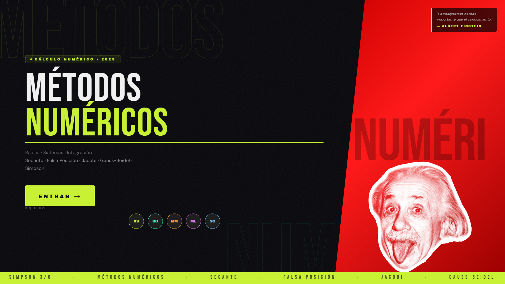

# Métodos Numéricos App

Aplicación web para resolver problemas de métodos numéricos paso a paso. La hicimos como proyecto de la materia de Métodos Numéricos en el Instituto Tecnológico de Cuautla (TecNM).

🔗 **Demo:** [metodos-numericos-app.netlify.app](https://metodos-numericos-app.netlify.app/)



## ¿Qué hace?

Metes los datos del problema, eliges el método y la app calcula el resultado mostrando las iteraciones. Incluye 7 métodos, organizados en tres temas:

| Tema | Métodos |
|------|---------|
| Búsqueda de raíces | Secante, Falsa Posición (Regula Falsi) |
| Sistemas de ecuaciones | Jacobi, Gauss-Seidel |
| Integración numérica | Trapecio, Simpson 1/3, Simpson 3/8 |

## Características

- Todo en un solo archivo HTML, sin instalar nada
- Diseño responsivo, se adapta a celular y computadora
- Estilo visual propio con tipografías Bebas Neue, Archivo Black, Space Mono y DM Sans

## Tecnologías

- HTML, CSS y JavaScript (sin frameworks)
- Tabler Icons y Google Fonts
- Desplegada en Netlify

## Cómo usarla

Abre la demo, o descarga el repositorio y abre `index.html` en tu navegador:

```bash
git clone https://github.com/alondrasaavedra7u7-maker/metodos-numericos-app.git
cd metodos-numericos-app
```

## Equipo

- Saavedra Miguel Alondra
- Roque González Valeria
- Moreno Merino Lizbeth
- Mejía Elizalde Dayra
- Sedano Cedillo Samantha

## Licencia

MIT
